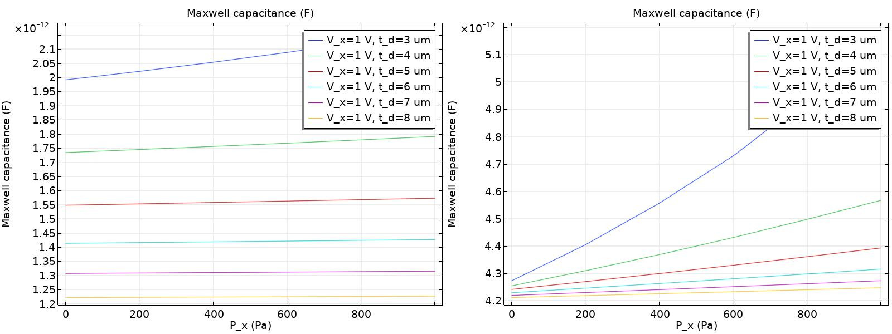
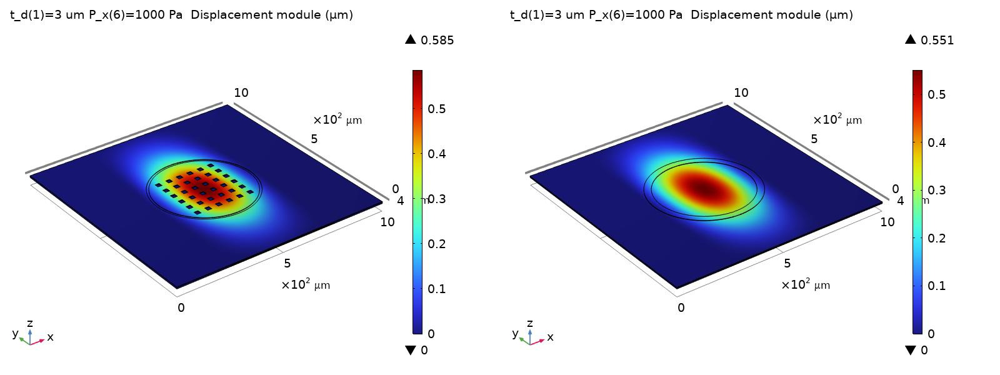
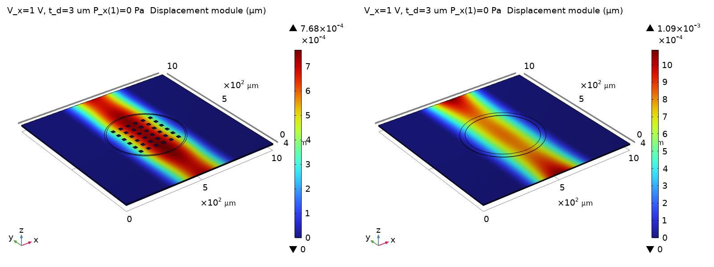
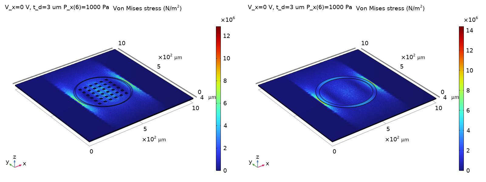

# Multiphysics Analysis of MEMS Capacitive Microphones

[](https://www.comsol.com)
[](#)
[](./)

Academic project for the **University of Pisa** focusing on the 3D finite-element electromechanical modeling and comparison of MEMS capacitive microphone architectures using **COMSOL Multiphysics 6.4**.

---

## Overview

Air viscosity within the sub-micron air gap of capacitive MEMS microphones introduces damping effects that degrade sensor linearity and acoustic performance. This study presents a comparative finite-element analysis (FEA) of two structural strategies designed to mitigate air resistance:

1. **Corrugated Diaphragm with Perforations**
2. **Perforated Diaphragm** vs. **Perforated Backplate**

The analysis evaluates membrane deflection, von Mises stress distribution, bias voltage-induced electromechanical effects, and capacitance sensitivity under applied pressure loads (0 to 1000 Pa).

---

## Physics & Modeling Setup

The 3D model integrates coupled multiphysics domains:

* **Solid Mechanics Module:** Evaluates structural deformation, elastic recovery, and peak von Mises stress across the corrugated aluminum diaphragm.
* **Electrostatics Module:** Computes the electric field distribution, Maxwell capacitance, and electrostatic attraction forces within the air gap.
* **Electromechanics Coupling:** Models the bidirectional interaction between diaphragm displacement and capacitance variation under a 1V DC bias potential.
* **Moving Mesh (ALE):** Handles domain deformation in the air gap between the moving diaphragm and fixed backplate.

---

## Key Results & Insights

### Capacitance vs. Pressure



### 3D Displacement Magnitude



### 3D Displacement Under Voltage Bias



### Von Mises Stress Distribution



---

## Repository Structure

```text
.
├── aliberti_progetto_articolo.pdf               # Reference paper / article
├── aliberti_progetto_testo.pdf                  # Assignment guidelines / specifications
├── COMSOL/                                      # COMSOL Multiphysics (.mph) model files
│   ├── no_corrugation_reinforcement/            # Models without corrugation reinforcement
│   │   ├── cap_mic-perf_back/
│   │   │   └── cap_mic-perf_back.mph
│   │   └── cap_mic-perf_diaphram/
│   │       └── cap_mic-perf_diaphram.mph
│   ├── only_diaphragm/                          # Simplified structural diaphragm models
│   │   ├── cap_mic-perf_back/
│   │   │   └── cap_mic-perf_back.mph
│   │   └── cap_mic-perf_diaphram/
│   │       └── cap_mic-perf_diaphram.mph
│   └── with_corrugation_reinforcement/          # Full models with corrugated diaphragm
│       ├── cap_mic-perf_back/
│       │   └── cap_mic-perf_back.mph
│       └── cap_mic-perf_diaphram/
│           └── cap_mic-perf_diaphram.mph
├── Excel/
│   └── Theoretical_membrane_displacement.ods    # Analytical validation calculations
├── Report/
│   ├── microphone_mems_comsol_report.pdf        # Final technical report (PDF)
│   └── microphone_mems_comsol_report/           # Full LaTeX source workspace
│       ├── main.tex
│       ├── references.bib
│       ├── chapter/                             # Modular report chapters (.tex)
│       └── img/                                 # Simulation plots & FEA figures
└── README.md
```

## References

- **Original paper:** [Design and Multiphysics Analysis of MEMS Capacitive Microphone — COMSOL](https://www.comsol.com/paper/design-and-multiphysics-analysis-of-mems-capacitive-microphone-19289)
- **Reference article:** [`aliberti_progetto_articolo.pdf`](./aliberti_progetto_articolo.pdf)
- **Project specifications:** [`aliberti_progetto_testo.pdf`](./aliberti_progetto_testo.pdf)
- **Final technical report:** [`Report/microphone_mems_comsol_report.pdf`](./Report/microphone_mems_comsol_report.pdf)
